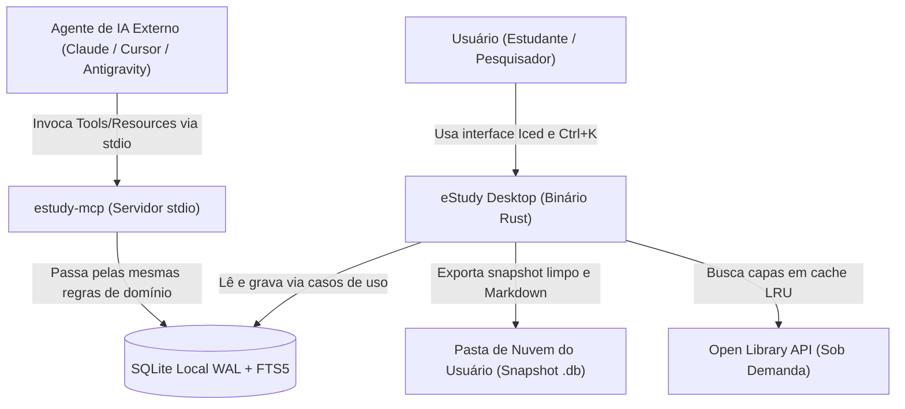
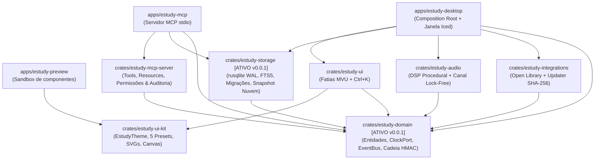

# Arquitetura C4 e Fronteiras do Workspace — eStudy

Este documento descreve como os módulos do **eStudy** se organizam em um grafo acíclico direcionado (DAG) sem ciclos de dependência, seguindo **Arquitetura Hexagonal (Ports & Adapters)** combinada com **Fatias Verticais** na camada de interface.

---

## 1. Nível 1 — Contexto de Sistema

---

## 2. Nível 2 — Topologia do Cargo Workspace (v0.0.1 $\rightarrow$ v1.0.0)

Na etapa atual (`v0.0.1`), estão ativos os crates **`estudy-domain`** e **`estudy-storage`**. Os demais crates entram nas etapas seguintes respeitando a mesma direção de dependências:

---

## 3. Regras de Fronteira

1. **`estudy-domain` é puro:** não depende de `rusqlite`, `directories`, sistema de arquivos, rede ou `Iced`. Recebe tempo via `ClockPort` e notifica efeitos colaterais pós-commit via `EventBusPort`.
2. **`estudy-storage` depende apenas de `estudy-domain`:** traduz modelos e regras do domínio para transações SQLite seguras sem expor detalhes SQL para as camadas superiores.
3. **Nenhuma operação de I/O entra no domínio:** futuras integrações (`estudy-audio`, `estudy-integrations`, `estudy-ui`) seguem a mesma inversão de dependência.
