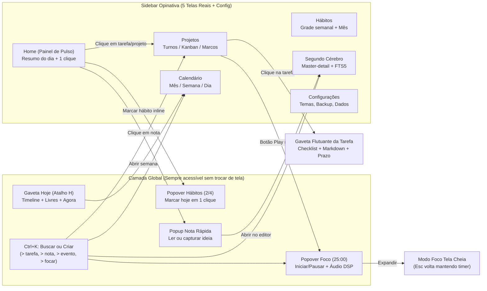

# Estudo de Arquitetura UX/UI, Fluxograma Funcional e Performance — eStudy `v0.6.1`

Este documento analisa o estado atual do **eStudy (`v0.6.0`)** sob a ótica de usabilidade real, densidade visual e engenharia de interface em `Iced 0.14` (`tiny-skia` CPU / `wgpu` opcional). O objetivo é servir de especificação direta para a entrega da **`v0.6.1`**, transformando uma interface hoje *bonita, porém engessada e com redundâncias* em uma estação de trabalho opinativa, fluida e abaixo do teto de **45 MiB de RAM**.

---

## 1. Diagnóstico Honesto da `v0.6.0` (O que trava a fluidez e a usabilidade)

A auditoria direta do shell MVU (`crates/estudy-ui/src/app.rs`) e das telas atuais revelou cinco problemas estruturais que explicam a sensação de rigidez:

### A. Redundâncias de Navegação e Controles
| Elemento atual (`v0.6.0`) | Onde aparece duplicado | Problema de usabilidade | Decisão para `v0.6.1` |
| :--- | :--- | :--- | :--- |
| **Foco / Pomodoro** | Sidebar (`Aprofundamento`), Topbar (`Focar`), Home (`Em foco`), Kanban (`Play`), `Ctrl+K` | Compete como "tela separada" quando na prática é uma **ação transversal** sobre qualquer tarefa. | Remover `Pomodoro` da lista principal de telas; manter o **Controle de Foco persistente na Topbar** (clique abre popover rápido; botão expande para tela cheia). |
| **Rotas "Em breve" na Sidebar** | `Estudos`, `Estante`, `Financeiro`, `Jardim & Pets`, `Loja` (5 de 12 itens) | 41% da barra lateral leva a telas vazias (*dead ends*), inflando a carga decisória (Lei de Hick). | Exibir na Sidebar **apenas módulos utilizáveis hoje** (5 rotas core + Configurações). Módulos futuros ficam sob um item discreto ou só entram quando entregues. |
| **Seletor de Tema e Modo na Topbar** | Botão `Oliva Orgânico` + botão `Sol/Lua` fixos na barra superior | Ação de baixíssima frequência ocupando espaço nobre de ações diárias. | Mover tema/modo para **Configurações** e para o **Popover do Perfil** (ou `Ctrl+K`). |
| **Ícone `Eye` para Hábitos Rápidos** | Topbar (`Icon::Eye` -> `HabitsQuick`) | Sem affordance: um olho não comunica "hábitos de hoje". | Trocar por um botão explícito com contador vivo (ex.: `Flame 2/4`) que abre o popover de hábitos de hoje. |
| **Dupla Barra Lateral** | Sidebar principal (`220px`) + barra contextual de Projetos/Calendário (`240px`) | Soma `460px` de barras laterais coladas, espremendo o Kanban/Calendário em notebooks (`1280px–1366px`). | **Regra de exclusividade espacial:** ao abrir a barra contextual de Projetos/Calendário ou um Drawer flutuante em janelas `< 1440px`, a sidebar principal recolhe automaticamente para `64px`. |
| **Cartão "Hoje" repetido** | Home, Gaveta Flutuante "Hoje", Projetos e Calendário | O usuário vê a mesma lista em 3 formatos diferentes sem saber qual é a fonte da verdade. | A **Gaveta Flutuante "Hoje"** (acessível de qualquer tela via Topbar/atalho `H`) é a timeline oficial do dia; a Home mostra apenas o **próximo compromisso imediato** + progresso. |

### B. Por que o visual atual parece "engessado"
1. **Síndrome da Caixa Igual (*Card-in-a-Box*):** Quase todas as seções usam `card(..., theme)` com o mesmo raio (`16px`), mesma borda `1px` e mesmo padding interno. O olhar não encontra contraste entre *estrutura* (fundo/respiro) e *objeto clicável* (tarefa, nota, hábito).
2. **Home sobrecarregada (10 blocos competindo):** Hero com 2 gráficos + Projetos + Hábitos + Segundo Cérebro + Hoje + Perfil + Em Foco + Humor + Quadro. Tudo disputa atenção com o mesmo peso visual.
3. **Interações ainda presas à troca de rota:** Criar uma nota rápida ou marcar um item de checklist de tarefa ainda exige navegar para outra tela, quando o usuário só quer resolver em 3 segundos e voltar ao que estava lendo.
4. **Aninhamento de scroll e redesenho desnecessário:** Containers com bordas e widgets recalculando layout completo durante scroll em CPU (`tiny-skia`) deixam a resposta menos elástica.

---

## 2. Fluxograma Funcional Sem Redundâncias (`v0.6.1`)

O princípio norteador da `v0.6.1` é: **uma única porta de entrada para cada intenção, e nenhuma ação corriqueira deve obrigar a saída da tela atual.**

### Hierarquia de Camadas e Tecla `Esc` (Pilha Previsível)
A tecla `Esc` fecha **exatamente uma camada por vez**, da mais superficial para a mais profunda, sem nunca deixar overlays presos:
1. `CommandPalette` (`Ctrl+K`)
2. `QuickPopup` (Nota, Hábitos Rápidos, Foco Rápido, Notificações)
3. `FloatingDrawer` (Gaveta "Hoje" ou Gaveta da Tarefa)
4. `FocusFullscreen` (sai da tela cheia mantendo o cronômetro rodando no badge da Topbar)

---

## 3. UI Declarativa e Opinativa: Cada Coisa no Seu Lugar Com Propósito

Em vez de "oferecer tudo em todo lugar", a interface assume uma postura clara sobre **onde cada informação mora**:

### A. Anatomia das 4 Zonas da Janela
1. **Sidebar Esquerda (`220px` expandida / `64px` compacta — coordenada fixa):**
   - **Propósito único:** trocar de *contexto de trabalho* (Home, Projetos, Hábitos, Segundo Cérebro, Calendário) e acessar Configurações no rodapé.
   - **Sem ruído:** máximo de 1 badge numérico discreto por rota (tarefas abertas, hábitos `X/Y`).
   - **Mascote contextual (rodapé expandido):** reage ao progresso real do dia (sem competir com a navegação).
2. **Topbar (`44px` limpa e sem gordura):**
   - **Esquerda:** Breadcrumb + título do contexto atual (ex.: `Projetos / Faculdade`).
   - **Centro:** Gatilho da Barra de Comando (`Buscar ou criar... Ctrl+K`) como âncora visual.
   - **Direita (máximo 4 utilitários transversais):**
     1. `Hoje` (abre a Gaveta Flutuante da Timeline)
     2. `Hábitos · 2/4` (abre o Popover de marcação rápida)
     3. `Focar` ou `Focar · 24:12` (CTA primário único — abre o Popover de Foco / Áudio)
     4. `Notificações` (sino com indicador só quando houver alerta real)
3. **Palco Principal (Sem "caixas dentro de caixas"):**
   - **Fundo `bg_base` respirável:** títulos editoriais (`Lora`), filtros segmentados e cabeçalhos de seção ficam **diretamente sobre o fundo**, sem envoltório de cartão.
   - **Cartões (`surface`) reservados a objetos de trabalho:** só entra em cartão o que tem estado vivo ou ação direta (um card de tarefa, uma nota, um gráfico de pulso, uma linha de hábito).
   - **Home em 2 zonas assimétricas (`8fr / 4fr`) com no máximo 5 blocos:**
     - *Esquerda (`8fr`):* Saudação + captura rápida inline (1 linha) $\rightarrow$ **Pulso de Foco (14d) + Constância Anual (365d)** $\rightarrow$ **Projetos Ativos** (grade 2 colunas colorida).
     - *Direita (`4fr`):* **Em Foco Agora (`X/5`)** (com Play direto) $\rightarrow$ **Hábitos de Hoje** (check direto) $\rightarrow$ **Notas Fixadas** (abre em popup) + **Humor do Dia** (compacto em 1 faixa, sem cartão gigante).
     - *Removido da Home:* cartão de Perfil decorativo (avatar/nome já pertencem à saudação ou Configurações) e cartão "Hoje" duplicado (vive na Gaveta Flutuante).
4. **Camada de Sobreposição Leve (Popups e Gavetas):**
   - **Gaveta Flutuante (`380px–440px`, margem `12px`, raio `20px`):** usada para *detalhe profundo sem perder o contexto* (Timeline "Hoje" e Detalhe da Tarefa).
   - **QuickPopup (`420px–480px`):** usado para *ações de < 10 segundos* (ler/capturar nota, marcar hábito, controlar Pomodoro + faixa DSP).

---

## 4. Levando `Iced 0.14` + `tiny-skia` ao Limite Mantendo RAM < 45 MiB

É perfeitamente possível ter uma interface moderna, tátil e com cara de software artesanal em Rust puro **sem Electron, sem WebView e sem estourar 45 MiB de RAM**. O segredo está em respeitar a física do rasterizador em CPU (`tiny-skia`) e do modelo MVU do `Iced`:

### Técnicas de Alto Impacto Visual e Baixo Custo de RAM/CPU
1. **Profundidade Óptica sem Blur Gaussiano:**
   - *Por que evitar `Shadow { blur_radius > 0 }`:* em CPU (`tiny-skia`), cada sombra desfocada aloca um buffer RGBA extra e executa convolução a cada frame de scroll.
   - *Solução moderna:* usar **contraste tonal em 4 degraus** (`bg_base` $\rightarrow$ `surface` $\rightarrow$ `surface_soft` $\rightarrow$ `surface_elevated`) + borda `1px` de baixo contraste (`border_subtle`) + barra lateral de acento (`3px` tintado à esquerda em itens ativos/selecionados). Custo de CPU: **zero**; custo de RAM: **zero**.
2. **Cache Vetorial Granular (`canvas::Cache`) em Todos os Widgets Customizados:**
   - O `HeatmapGrid` (batch em 5 `Path`s) e o `SparklineCanvas` (cache por hash dos dados) já reduziram o custo de scroll.
   - Na `v0.6.1`, aplicar o mesmo padrão de `canvas::Cache` para:
     - **Barras de progresso de Hábitos** e **mini-gráfico de aderência mensal**;
     - **Cápsulas proporcionais e régua `Agora`** da Gaveta "Hoje".
3. **Animações Sob Demanda (Zero Polling em Repouso):**
   - Nunca manter `Subscription` de 60fps ligada quando a tela está parada.
   - Qualquer transição futura (ex.: progresso de barra ou feedback visual) deve usar uma janela curta com término explícito (`<= 180ms`) que desliga a `Subscription` assim que atinge o estado final. Em repouso, CPU = **0%** e `VmRSS` permanece estável em **~35 MiB**.
4. **Alocação Preguiçosa e Projeção de Estado no Backend (`estudy-storage`):**
   - Evitar carregar o corpo completo (`body_md`) de centenas de notas do Segundo Cérebro na inicialização: carregar apenas **metadados + resumo (`excerpt` de 140 chars)** para a grade e ler o corpo completo sob demanda ao clicar na nota.
   - Manter o limite `PRAGMA cache_size = -4000` (4 MiB) no SQLite WAL e paginação/limite por consulta (`LIMIT 50`) nas listas de histórico.
5. **Prevenção de Scroll Duplo e Layout Thrashing:**
   - Garantir no máximo **1 `scrollable` principal por tela** (evitando `scrollable` aninhado dentro de `scrollable`, que fragmenta o clipping e exige múltiplos passes de layout no `Iced`).
   - Usar larguras explícitas ou `Length::FillPortion` estáveis em grades (evitando `Length::Shrink` em containers largos que forçam medição em duas passadas).
6. **Caminho GPU Opcional Preservado:**
   - O backend padrão continua `tiny-skia` (`~35 MiB` RAM, boot `10 ms`). Usuários com monitores 120Hz/4K podem compilar ou rodar com `--features gpu` (`wgpu`) usando exatamente o mesmo código de UI.

---

## 5. Plano de Testes de Usabilidade e Fluxo de Uso (`v0.6.1`)

Para garantir que a `v0.6.1` não regrida em ergonomia, criaremos a suíte **`crates/estudy-ui/tests/usability_flows.rs`** testando **jornadas completas de usuário** e invariantes de UX em MVU puro (sem precisar abrir janela X11/Wayland):

| # | Jornada de Usabilidade Testada | Critério de Sucesso (Assert) |
| :--- | :--- | :--- |
| **UF-01** | **Ação rápida sem sair da tela:** usuário está em *Projetos*, abre `QuickPopup::HabitsQuick`, marca 1 hábito, fecha com `Esc`. | Rota continua `AppRoute::Projects`, hábito marcado persiste no estado, `active_popup == None`. |
| **UF-02** | **Disparo de foco em 1 clique:** usuário clica `Play` em uma tarefa no Kanban/Turnos -> abre controle de foco vinculado -> pausa -> volta. | `focus_state.active_task_id == Some(task.id)` e título sincronizado sem perder o projeto selecionado. |
| **UF-03** | **Pilha previsível da tecla `Esc`:** abrir Gaveta "Hoje" + `QuickPopup::Note` + `Ctrl+K`, depois enviar `CloseOverlays` 3 vezes. | Cada `Esc` fecha exatamente 1 camada na ordem (`Palette` -> `QuickPopup` -> `TodayDrawer`), nunca fechando tudo de uma vez nem travando estado. |
| **UF-04** | **Regra anti-dupla-sidebar:** em *Projetos* ou *Calendário*, abrir a barra contextual (`Ctrl+B`) quando a sidebar principal está expandida. | Sidebar principal auto-recolhe (ou respeita modo compacto) evitando colisão visual; ao fechar, restaura ou mantém estável. |
| **UF-05** | **Navegação sem becos sem saída (*Zero Dead-Ends*):** iterar todas as rotas expostas na navegação primária. | 100% das rotas primárias possuem estado funcional real (nenhuma tela principal cai em placeholder genérico "Em breve"). |
| **UF-06** | **Captura rápida global (`Ctrl+K`):** digitar `> nova tarefa Revisar cálculo`, `> focar 25m` e busca `FTS5` a partir de qualquer rota. | Ação executa, exibe feedback transitório e fecha o overlay em 1 passo. |

---

## 6. Sequência Recomendada de Execução da `v0.6.1`

1. **Fatia 1 — Limpeza Estrutural de Navegação & Topbar Opinativa:** remover rotas "Em breve" da sidebar primária, mover tema/modo para Configurações, trocar `Icon::Eye` por contador `Hábitos · X/Y`, implementar pilha ordenada de `Esc` e regra anti-dupla-sidebar.
2. **Fatia 2 — Home Desengessada (Ritmo Editorial & Sem Redundância):** enxugar a Home para os 5 blocos essenciais com ações inline, cabeçalhos diretamente sobre `bg_base` e captura rápida inline.
3. **Fatia 3 — Suíte de Testes de Usabilidade (`usability_flows.rs`):** validar as 6 jornadas `UF-01` a `UF-06` em TDD.
4. **Fatia 4 — Migração SQLite v2 & Lazy-Loading:** persistir `habits`, `habit_logs`, `weekly_turns` e ligar `SecondBrain` à tabela `notes`/`notes_fts` existente com carregamento sob demanda do corpo das notas, seguido de novo benchmark (`scripts/bench_and_validate.sh`) confirmando `VmRSS < 45 MiB`.
